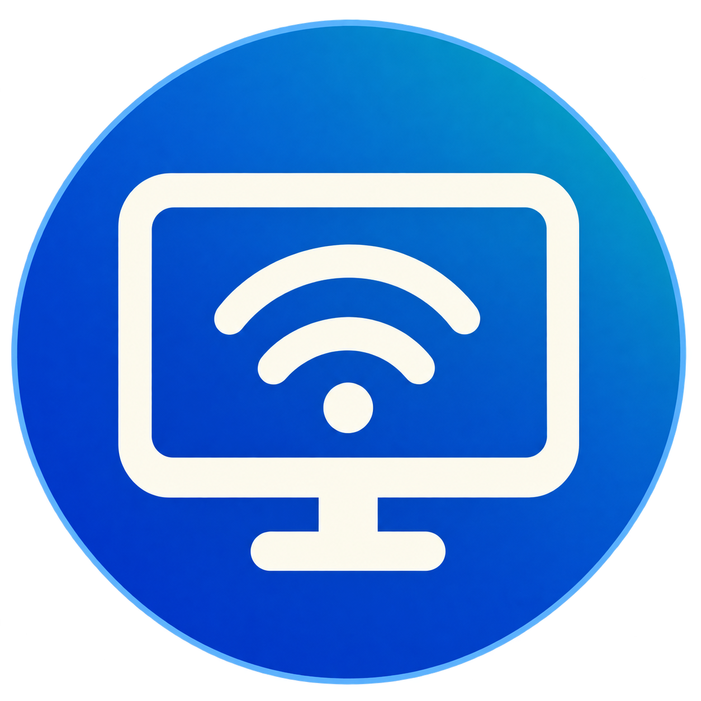

# ScreenTask 2.0 🖥️⚡

[](https://screentask.eslamx.com/)
[](https://github.com/lucavandro/ScreenTask/actions/workflows/ci.yml)
[](https://github.com/lucavandro/ScreenTask/releases/latest)
[](https://github.com/lucavandro/ScreenTask/releases)
[](https://github.com/lucavandro/ScreenTask/releases/latest)
[](https://github.com/EslaMx7/ScreenTask/stargazers)
[](https://dotnet.microsoft.com/)
[](https://www.gnu.org/licenses/gpl-3.0.html)

**Free, open-source, portable Windows screen and audio sharing over local Wi-Fi, Ethernet LAN, or mobile hotspot, with frame-rate targets up to 60 FPS. No internet connection is required for streaming.**

Viewers connect through a modern web browser on a desktop, tablet or smartphone,
without installing client software, browser extensions or cloud accounts.

**Optional WebRTC video:** Settings & Logs → Video transport offers H.264 over
WebRTC alongside the default JPEG/WebSocket mode, with per-viewer JPEG fallback.
See [setup, compatibility and measured tradeoffs](docs/WEBRTC_MODE.md).

The current source release is **2.1.0** (tag **v2.1.0**). This checkout includes the capture, performance, desktop and web-viewer updates
described below. The CI, release and download badges track this repository;
the stars badge refers to the original upstream project.

🌐 **Official Website**: [https://screentask.eslamx.com/](https://screentask.eslamx.com/) · 🚀 **What's New in 2.0**: [https://screentask.eslamx.com/v2](https://screentask.eslamx.com/v2) · 📦 **Legacy v1.2 Archive**: [https://screentask.eslamx.com/v1](https://screentask.eslamx.com/v1)

[](https://screentask.eslamx.com/)

The upstream screenshot above predates the current dark theme, circular icon,
firewall indicator and video-transport selector.

---

## 📥 Direct Downloads

Download **ScreenTask 2.1.0 from this repository** below, or open the
[latest release](https://github.com/lucavandro/ScreenTask/releases/latest) and expand
**Assets**. Choose the standalone EXE if you do not want to install .NET.
The automatic source-code ZIP/TAR archives do not contain a compiled application.

| Edition | Requirements | Download |
| :--- | :--- | :--- |
| **ScreenTask 2.1.0 Standalone `.EXE`** | Windows 10/11 x64; .NET included | [Standalone .EXE](https://github.com/lucavandro/ScreenTask/releases/download/v2.1.0/ScreenTask-v2.1.0-win-x64-standalone.exe) |
| **ScreenTask 2.1.0 Lightweight Portable `.ZIP`** | Windows 10/11 x64; .NET 9 Desktop Runtime and ASP.NET Core Runtime 9 | [Portable .ZIP](https://github.com/lucavandro/ScreenTask/releases/download/v2.1.0/ScreenTask-v2.1.0-win-x64-portable.zip) |
| **SHA-256 checksums** | Verify the matching release files | [SHA256SUMS.txt](https://github.com/lucavandro/ScreenTask/releases/download/v2.1.0/SHA256SUMS.txt) |
| **ScreenTask v1.2 Classic** | Legacy Windows / 32-bit archive | [Legacy archive](https://screentask.eslamx.com/v1) |

Original upstream versions remain available in the
[upstream releases](https://github.com/EslaMx7/ScreenTask/releases).

---

## ✨ What's New in ScreenTask 2.0 (10-Year Anniversary Edition)

ScreenTask 2.0 is a ground-up modernization of the original 2015 utility:

* 🚀 **Adjustable Streaming Rate**: Choose a 15, 30 or 60 FPS target. Capture, encoding, network and viewer decoding determine the achieved rate; neither 60 FPS nor a fixed end-to-end latency is guaranteed.
* 🔊 **System & Microphone Audio Sharing**: Stream live PC system audio (WASAPI Loopback) or microphone input through the existing PCM/Web Audio channel. Audio is opt-in and muted by default; WebRTC mode changes video transport, not the audio pipeline.
* 🪟 **Window & Application Sharing**: Share individual open applications (e.g. Visual Studio Code, PowerPoint, browser windows) using the visual thumbnail picker (`Pick Visually...`) instead of exposing your entire desktop.
* 📱 **Instant QR Code Pairing**: Desktop app generates a crisp vector QR code right on the main Broadcast tab (with click-to-enlarge projector modal) so viewers can point their phone camera at the PC screen and start watching immediately.
* 👥 **Connected Viewers & Fleet Management**: Real-time LAN viewer list with device & browser identification, live RTT ping measurement, active view mode detection (Pinch Zoom, Fullscreen), individual viewer audio mute, disconnect/kick controls, and on-screen broadcast toast announcements.
* 🖥️ **Native Light/Dark Desktop UI**: The three tabs (`Broadcast`, `Connected Viewers`, `Settings & Logs`) follow the Windows 11 app theme at startup. Windows 10 retains the classic palette; High Contrast uses system colors. Restart ScreenTask after changing the Windows theme.
* 💾 **In-Memory Media Processing**: Frames and audio are captured, encoded and streamed without media files on disk. Settings and the extracted native WebRTC runtime can still be stored locally; this is not a promise of zero application disk writes.
* 🔒 **Lock Screen & Sleep Resilience**: Handles Windows lock screen (`Win + L`) and desktop session switching gracefully without crashing or disconnecting viewers.
* 🎨 **Next-Gen Mobile-First Web Viewer**: Redesigned with the Slate & Dynamic Indigo theme from [screentask.eslamx.com](https://screentask.eslamx.com/), featuring:
  * Fullscreen & mobile pinch-to-zoom (up to 5x) plus double-tap zoom for reading fine text and code on smartphones.
  * [Collapsible fullscreen controls](docs/WEB_VIEWER.md), fitted stream content, touch-sized actions and keyboard navigation.
  * Web Audio API player with volume slider and mute controls.
  * Live stream HUD (FPS counter, resolution, RTT latency).
  * Clean 4-digit PIN authentication dialog.
* ⚡ **Modern .NET 9 & Standalone Portability**: Upgraded from legacy .NET Framework 4.8 to modern .NET 9 with pure Single-File publishing and embedded web assets.

### Capture and streaming improvements

* **GPU monitor capture** uses DXGI Desktop Duplication on the selected display's
  adapter. GDI is the automatic fallback when duplication is unavailable, lost or
  unsupported for the display. Application-window sharing retains PrintWindow.
* **Precise frame pacing** uses cancellable high-resolution frame deadlines on a
  dedicated worker, without busy-waiting or changing the global timer resolution.
* **Parallel capture and encoding** overlap on separate workers. A single pending
  slot retains the newest frame, discarding obsolete captures. Freeze, source
  changes, stop and restart respect frame ownership and worker shutdown.
* **Slow viewers do not stall fast viewers**: each WebSocket client has bounded
  sending work and can skip frames. Browser JPEG decoding likewise keeps one
  active decode and only the latest waiting frame.
* **Diagnostics**: hover over the desktop FPS indicator for capture backend,
  capture/encode time, queue wait and host frame age. `/api/status` also exposes
  these timings, pending/discarded captures, transport and encoder information.
  Host frame age excludes network, browser decoding and physical display latency.

Details: [capture](docs/DESKTOP_CAPTURE.md), [frame pacing](docs/FRAME_PACING.md)
and [parallel pipeline measurements](docs/PARALLEL_PIPELINE.md).

### Desktop appearance and firewall status



The current circular blue icon uses a filled monitor/broadcast symbol and
transparent outer corners. The executable, main window and notification-area
icon share nine sizes from 16 to 256 pixels, checked on light and dark backgrounds.
The [appearance guide](docs/DESKTOP_APPEARANCE.md) explains theme behavior and
rebuilding the ICO with `scripts/Build-AppIcon.ps1`.

The last desktop status-bar item is now a **Windows Firewall indicator**, replacing
the former copyright link. Application credits remain in Help/About and source
notices. The indicator distinguishes Allowed, Blocked, Unknown/Checking, Off and
Local only for the selected adapter and port. Its tooltip explains the result;
clicking it opens Settings & Logs. Checks run in the background without elevation
or rule changes. WebRTC checks include both TCP and UDP.

**Allow Port in Windows Firewall (Admin)** remains an explicit user action. A
green policy indication is not a guarantee against Wi-Fi isolation, router rules
or third-party filters. See [firewall status and limitations](docs/FIREWALL_STATUS.md).

### Web viewer and fullscreen

The fullscreen button lives in the header actions; the GitHub shortcut has been
removed from that bar. Fullscreen hides both bars and leaves one small button in
the top-right corner to reopen them. Open controls overlay the stream without
moving or resizing it, and close after five seconds of inactivity. Hover,
keyboard focus and open dialogs keep them available; tapping the stream closes
them immediately.

The active JPEG canvas or WebRTC video is centered and fitted with its original
aspect ratio. The inactive surface no longer occupies space or crops the image.
Controls wrap on small screens, respect fullscreen safe areas and provide
44-pixel touch targets, accessible labels, visible focus and reduced-motion
support. PIN/audio dialogs contain keyboard focus; audio diagnostics returns
focus to its opener when closed. The web theme toggle remains available.

| Key | Action outside text fields and dialogs |
| :--- | :--- |
| **F** | Enter/exit fullscreen |
| **H** | Show/hide fullscreen controls |
| **M** | Toggle viewer audio |
| **S** | Save a PNG screenshot |
| **0** | Fit to screen; reset zoom and pan |
| **+ / −** | Zoom in/out |
| **Esc** | Close audio diagnostics or exit simulated fullscreen; native fullscreen also has browser exit controls |

Native fullscreen and the existing WebKit/simulated fallback share the same
controls. See the [viewer guide](docs/WEB_VIEWER.md) and
[browser/accessibility QA report](docs/WEB_VIEWER_QA.md) for verified behavior
and remaining physical-device checks.

### Image quality and video transport

In **Settings & Logs**, **Image Quality** controls lossy JPEG compression
(20–100). Lower values generally reduce detail and frame size; 80 does not mean
80% of the original file size. This can relieve encoding or bandwidth pressure,
but does not change capture resolution or guarantee more FPS. See
[Image Quality and framerate](docs/IMAGE_QUALITY.md).

Stop broadcasting before changing **Video transport**:

| Mode | Video | Network and quality behavior |
| :--- | :--- | :--- |
| **JPEG / WebSocket** — default | In-memory JPEG frames | TCP on the selected port; Image Quality applies |
| **WebRTC / H.264** — optional | Shared Windows Media Foundation encoder, hardware first with software initialization fallback | UDP on the same port number; fixed 8 Mbps bitrate target; per-viewer JPEG fallback |

The mode is saved between runs. WebRTC uses no public STUN/TURN service and
falls back to JPEG when unavailable. Audio, PIN checks, announcements and
telemetry keep using the existing channels. The JPEG quality slider is disabled
in WebRTC mode, but its value is retained for JPEG fallback. `/ScreenTask.jpg`
remains JPEG; RTC-only audiences refresh that snapshot at most once per second.
Mixed JPEG/WebRTC audiences require both encoders and more host work.

Windows x64 and a usable Media Foundation H.264 encoder are required for WebRTC;
missing media components or unsupported viewers use JPEG. See
[WebRTC setup, compatibility and measurements](docs/WEBRTC_MODE.md).

**WebP was evaluated and removed.** The tested encoder was slower in all 27
configurations, by 9.1–15.9× versus JPEG, without sufficient overall throughput
benefit. Old WebP settings remain loadable without losing other settings. This
is a result for the tested implementation, not a universal codec ranking; see
[the full WebP evaluation](docs/WEBP_PERFORMANCE.md). The separate Skia JPEG
experiment was also not retained; its results are in the
[frame-pacing report](docs/FRAME_PACING.md).

### Measured performance and limits

The local comparisons below used different implementation stages. Do not add
their gains together or interpret them as measurements on an Android phone.

| Change | Workload | Recorded result |
| :--- | :--- | :--- |
| GDI → DXGI monitor capture | 2560×1080, JPEG quality 80, target 30 | Host pipeline 10.15 → 26.82 FPS |
| Precise frame pacing | DXGI monitor, target 30 | Median 26.33 → 29.99 FPS |
| Parallel capture/JPEG workers | DXGI monitor, target 60 | Median 29.60 → 52.46 FPS (**+77.2%**) |

The parallel test increased CPU use and host frame-age p95 from 40.86 to
48.12 ms. Higher throughput is not the same as lower latency. These host tests
excluded Wi-Fi congestion, phone decoding and physical presentation; full
methods and raw evidence are linked from the performance reports above.

In a separate 15-second Full HD synthetic Chrome comparison, WebRTC used
**5.57 Mbps versus JPEG's 20.39 Mbps (72.7% less video payload)**, but achieved
**40.6 browser frames/s excluding drops versus 54.5 JPEG decodes/s**. That
bandwidth reduction did not establish a framerate improvement on Android/Wi-Fi.
Choose a mode by the bottleneck on the actual devices, rather than assuming
H.264 is always faster.

---

## 📊 Version Comparison

| Feature | ScreenTask 1.x (2015–2022) | ScreenTask 2.0 (2026) |
| :--- | :--- | :--- |
| **Streaming Protocol** | HTTP Polling (`img.src = ...?rand=`) | **JPEG/WebSocket or optional WebRTC/H.264 video; separate PCM audio** |
| **Frame Rate** | ~2–5 FPS (slideshow) | **15/30/60 FPS targets; achieved rate depends on the complete pipeline** |
| **Latency** | Polling adds delay | **Depends on capture, encoding, network and viewer; host timings are reported separately** |
| **Audio Streaming** | ❌ No | **✅ Yes (WASAPI System & Mic Audio)** |
| **Capture Sources** | Full monitors only | **Full monitors + Individual app windows** |
| **Viewer Management** | ❌ None (blind broadcast) | **✅ Live viewer list, RTT ping, mute/kick & toast alerts** |
| **Media Disk I/O** | Writes `ScreenTask.jpg` to disk | **Media stays in memory; settings/native runtime can use disk** |
| **Mobile Pairing** | Manual IP & port typing | **Instant QR Code Camera Scan** |
| **Mobile Gestures** | Fixed viewport | **Pinch-to-zoom (5x) & two-finger pan** |
| **Host Runtime** | Legacy .NET Framework 4.5 / 4.8 | **Modern .NET 9 Standalone Single-File** |
| **Desktop Appearance** | Classic UI | **Windows 11 light/dark theme, circular app icon, firewall status** |

---

## 🚀 Getting Started

### 1. Host (Sharing your screen)

1. Download a Windows x64 package from this repository in [Direct Downloads](#-direct-downloads).
2. Extract the complete portable ZIP and launch the executable. Self-contained builds require no .NET installation or external `WebServer` folder. Close older ScreenTask copies, including the tray instance, before updating.
3. Select your **Network Interface & Port** (Wi-Fi, Mobile Hotspot, or Ethernet).
4. Choose your capture source under **Share** (full Display or click **Pick Visually...** to choose a specific application window).
5. Check **Stream Audio** (or click **Unmute Audio**) if you want to broadcast PC system sound or microphone audio.
6. In **Settings & Logs**, choose the FPS target, JPEG quality and optional WebRTC video mode. Start with the default JPEG mode if unsure; inspect the firewall indicator for the selected port.
7. Click **▶ START BROADCAST**.

### 2. Viewers (Watching the stream)

* **On Mobile / Tablet**: Scan the QR code shown in the bottom-right corner of the ScreenTask window using your phone camera.
* **On Desktop / Laptop / Smart TV**: Open any modern web browser and navigate to the displayed **Stream Web Address** (e.g. `http://192.168.1.100:7070`).
* Enter the session PIN if requested; enable viewer audio when needed. Use the header fullscreen button, then the small corner button to reveal controls. Reload the viewer after updating the host executable.

---

## 🛠️ Building & Testing from Source

### Prerequisites

* Windows 10 (version 1809+) or Windows 11
* [.NET 9.0 SDK](https://dotnet.microsoft.com/download/dotnet/9.0) for development — the Desktop Runtime alone cannot build the project. See [Windows SDK setup](docs/WINDOWS_SETUP.md).
* Node.js for JavaScript syntax and viewer tests; no npm/webpack build step is required.

### Build, Test & Publish Commands

```powershell
# Clone repository
git clone https://github.com/lucavandro/ScreenTask.git
cd ScreenTask

# Verify the SDK and restore dependencies
dotnet --list-sdks
dotnet restore

# Build solution (delivery builds must have no warnings/errors)
dotnet build -c Release

# Run automated unit, integration, and STA UI tests
dotnet test -c Release

# Verify the embedded web client and run all viewer tests
node -c ScreenTask/WebServer/viewer.js
node --test ScreenTask.Tests/Web/*.test.cjs
```

The latest recorded local validation (18 November 2026) passed **105 .NET tests
and 23 JavaScript tests**, with zero Release build warnings/errors. Browser checks
covered desktop and emulated mobile viewports, native/simulated fullscreen,
JPEG/WebRTC, zoom, screenshots and PIN/dialog focus. Physical Android/iOS,
screen-reader and complete accessibility certification were not established;
the [QA report](docs/WEB_VIEWER_QA.md) records incomplete checks explicitly.

### Portable Windows x64 builds

Prepare the native runtime before publishing a distributable portable build.
This downloads a pinned, SHA-256-checked Microsoft runtime archive and embeds its
app-local fallback libraries; it does not install them on the development PC.

```powershell
./scripts/Prepare-WebRtcRuntime.ps1

# Self-contained single-file host with embedded viewer/native resources
dotnet publish ScreenTask/ScreenTask.csproj -c Release -r win-x64 --self-contained true `
  -p:PublishSingleFile=true -p:IncludeNativeLibrariesForSelfExtract=true `
  -p:DebugType=None -p:DebugSymbols=false -o build/portable-win-x64

Copy-Item README.md build/portable-win-x64/
Compress-Archive -Path build/portable-win-x64/* `
  -DestinationPath build/ScreenTask-win-x64-portable.zip -Force
Get-FileHash build/ScreenTask-win-x64-portable.zip -Algorithm SHA256
```

Keep **DirectX-NOTICE.txt** and **WebRTC-NOTICE.txt** with distributed binaries.
WebRTC native libraries are extracted and hash-checked under
`%LOCALAPPDATA%\ScreenTask\Native` when needed; installed system runtime libraries
are preferred. Settings are saved under `%APPDATA%\ScreenTask\settings.xml`.

For the smaller framework-dependent edition, use `--self-contained false` and
omit `IncludeNativeLibrariesForSelfExtract`. The receiving PC needs both the
**.NET 9 Desktop Runtime** and **ASP.NET Core Runtime 9**: the app uses WinForms
and an embedded ASP.NET Core server. See [portable packaging details](docs/WINDOWS_PORTABLE.md).

CI prepares the runtime, checks JavaScript, builds, tests and produces a standalone
artifact. The release workflow packages standalone/framework-dependent editions,
notices and SHA-256 checksums for explicit `vMAJOR.MINOR.PATCH` release tags. To
publish an existing tag, run **Actions → Publish GitHub Release → Run workflow**
from `master` and enter the tag (for example `v2.1.0`). The workflow builds that
tag's source and checks that its project version matches before publishing.
An ordinary push does not publish a release. Generated local EXEs and ZIPs stay
in ignored `build/`. See [release publishing](docs/WINDOWS_PORTABLE.md#publishing-a-github-release).
Follow [AGENTS.md](AGENTS.md) for repository collaboration and delivery requirements,
including separate commits for independent requests.

---

## 💬 Feedback, Bug Reports & Feature Requests

Have an idea for ScreenTask 2.0 or encountered an issue?
* **In-App**: Click **Report Bug / Request Feature** in the top menu bar (or **Help → Report a Bug...**) to generate a pre-filled template with system & session diagnostics.
* **GitHub Issues (Recommended)**: [Open an Issue on GitHub](https://github.com/EslaMx7/ScreenTask/issues)
* **Email Support**: Send feedback or private diagnostic logs to [support@eslamx.com](mailto:support@eslamx.com)

---

## 📚 Guides & Documentation

Local guides for the current implementation:

| Topic | Documentation |
| :--- | :--- |
| SDK installation and Windows development setup | [Windows setup](docs/WINDOWS_SETUP.md) |
| Standalone and lightweight portable packaging | [Windows portable builds](docs/WINDOWS_PORTABLE.md) |
| GPU capture and GDI fallback | [Desktop capture](docs/DESKTOP_CAPTURE.md) |
| Timing improvements and rejected JPEG encoder trial | [Frame pacing](docs/FRAME_PACING.md) |
| Capture/encoding parallelization and benchmark evidence | [Parallel pipeline](docs/PARALLEL_PIPELINE.md) |
| JPEG compression and FPS | [Image Quality](docs/IMAGE_QUALITY.md) |
| Current formats and the WebP removal decision | [Video formats](docs/VIDEO_FORMATS.md), [WebP evaluation](docs/WEBP_PERFORMANCE.md) |
| WebRTC video, fallback, runtime and measured tradeoffs | [WebRTC mode](docs/WEBRTC_MODE.md) |
| Windows theme and circular icon | [Desktop appearance](docs/DESKTOP_APPEARANCE.md) |
| Effective TCP/UDP Windows Firewall indication | [Firewall status](docs/FIREWALL_STATUS.md) |
| Fullscreen, touch, keyboard and accessibility checks | [Web viewer](docs/WEB_VIEWER.md), [QA report](docs/WEB_VIEWER_QA.md) |

Explore step-by-step tutorials on the official website:
* [How to Share PC Screen Over Wi-Fi Without Internet (Mobile Hotspot)](https://screentask.eslamx.com/guides/share-pc-screen-wifi-hotspot-without-internet)
* [How to Stream PC Screen to Phone or Tablet Browser](https://screentask.eslamx.com/guides/stream-pc-screen-to-phone-tablet-browser)
* [Windows 11 ScreenTask Setup & Firewall Guide](https://screentask.eslamx.com/guides/windows-11-setup-and-firewall)
* [Troubleshooting ScreenTask: Fixing Port Conflicts & Firewall](https://screentask.eslamx.com/guides/screentask-troubleshooting-connection-ip-port)

---

## 📜 License

ScreenTask is released under the **GNU General Public License v3.0 (GPLv3)**. See
the [GNU GPL v3 license text](https://www.gnu.org/licenses/gpl-3.0.html) for details.
Third-party dependencies and Microsoft runtime components retain their own terms;
see [DirectX-NOTICE.txt](ScreenTask/DirectX-NOTICE.txt) and
[WebRTC-NOTICE.txt](ScreenTask/WebRTC-NOTICE.txt).
